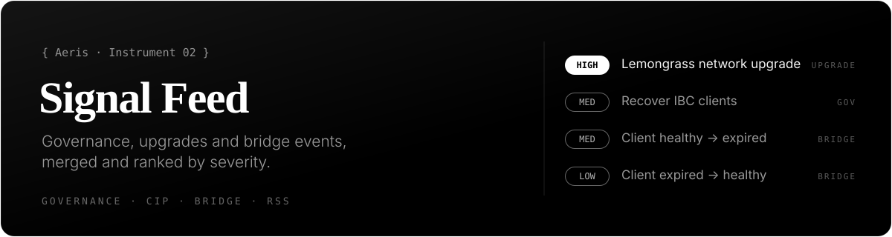

<a href="https://aerisvalidator.space/alerts/"></a>

# Signal Feed

One feed instead of three tabs. Signal Feed merges everything a Celestia operator has to keep an eye on into a single timeline, ranked by severity:

- **Governance:** on-chain proposals, from submission to result.
- **Network upgrades:** new and changed CIPs (Celestia Improvement Proposals).
- **Bridge health:** IBC client and Blobstream risk transitions from [Bridge & Client Watch](https://github.com/Aeris-io/bridge-client-watch).

Every entry carries the raw record that produced it: the proposal as the gov module returned it, the CIP header, the client-state change. Nothing is a summary written after the fact.

**Live:** [aerisvalidator.space/alerts](https://aerisvalidator.space/alerts/) · **JSON:** [`alerts_feed.json`](https://aerisvalidator.space/alerts/api/alerts_feed.json) · **RSS:** [`alerts_feed.xml`](https://aerisvalidator.space/alerts/api/alerts_feed.xml) · **API reference:** [docs/api.md](docs/api.md)

## Three ways to use it

**Read it.** Open the [live page](https://aerisvalidator.space/alerts/) and filter by category or severity.

**Subscribe.** Point any feed reader at the RSS. No account, no bot, no polling script.

```
https://aerisvalidator.space/alerts/api/alerts_feed.xml
```

**Build on it.** The JSON is what a Telegram or Discord bot would read. A ready-made Telegram relay is in [`examples/telegram_relay.py`](examples/telegram_relay.py).

## Categories and severity

| `category` | `kind` | Source |
|---|---|---|
| `governance` | `new_proposal`, `passed`, … | Celestia `gov` module through a public LCD |
| `network_upgrade` | `new_proposal`, status changes | CIP headers in [celestiaorg/CIPs](https://github.com/celestiaorg/CIPs) |
| `bridge_health` | `risk_change` | Bridge & Client Watch's event log |

Severity is `high`, `medium`, `low` or `info`. High means something an operator should act on now, for example a network upgrade that reached Final status.

An anomaly is reported once. A chain that stays expired doesn't produce a new alert every half hour.

## Quick start

```sh
# how many alerts, by severity
curl -s https://aerisvalidator.space/alerts/api/alerts_feed.json | jq .counts

# titles of high-severity alerts
curl -s https://aerisvalidator.space/alerts/api/alerts_feed.json \
  | jq -r '.alerts[] | select(.severity=="high") | .title'

# governance only, newest first, with a link
curl -s https://aerisvalidator.space/alerts/api/alerts_feed.json \
  | jq -r '.alerts | map(select(.category=="governance")) | sort_by(.ts_utc) | reverse[]
           | "\(.ts_utc[:10])  \(.title)  \(.source_url)"'
```

## License

Docs and examples: [MIT](LICENSE). The data is read from public chains and public repositories and is free to reuse.

---

<sub>Part of <a href="https://github.com/Aeris-io">Aeris</a> · <a href="https://aerisvalidator.space/">aerisvalidator.space</a></sub>
